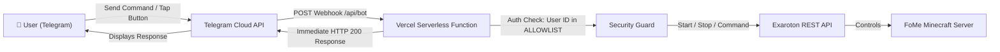

# Architecture & Project Conventions: ExServerWeb

## 1. Core Technology Stack

- **Primary Language**: **TypeScript** (Strict mode).
- **Framework**: [Next.js](https://nextjs.org/) (App Router, Server Components + Client Components where needed).
- **Styling**: [Tailwind CSS](https://tailwindcss.com/) (Dark mode / sleek modern HUD theme).
- **Deployment Platform**: [Vercel](https://vercel.com/) (Serverless Functions for API routes, Edge/CDN for static assets).
- **Telegram Framework**: [grammY](https://grammy.dev/) or [Telegraf](https://telegraf.js.org/) running in Webhook mode.
- **Server API Client**: Official `exaroton` SDK / REST API.
- **Map System**: [BlueMap](https://bluemap.bluecolored.de/) (WebGL 3D interactive viewer embedded + custom overlay layer).

---

## 2. Serverless Telegram Bot Architecture

### Key Architectural Invariants:

1. **Stateless Webhook**:
   - The bot does NOT run a polling loop (`bot.start()`). Instead, it handles incoming webhook updates via a Next.js Route Handler: `POST /api/bot`.
   - Execution finishes in < 2 seconds, well within Vercel's 15-second free tier limit.
2. **Access Control (Allowlist)**:
   - Only registered Chat IDs in `TELEGRAM_ALLOWED_USERS` (e.g. Soroqn and brother) can execute administrative actions.
   - Unauthorized users receive a silent ignore or access-denied message.
3. **No Long-Lived Sockets on Vercel**:
   - AFK bot spawning does not run a TCP bot client on Vercel.
   - It issues an Exaroton console command: `/player Steve spawn` (powered by the Fabric `Carpet` mod on the server).

---

## 3. Web Dashboard & BlueMap Integration

1. **Responsive Viewport**:
   - Clean HUD overlaying or embedding the BlueMap 3D WebGL viewport (`NEXT_PUBLIC_BLUEMAP_URL`).
2. **Status Widget**:
   - Live query of Exaroton server status (`ONLINE`, `OFFLINE`, `STARTING`), current RAM usage, and active player names.
3. **Hide & Seek Stealth Invariant**:
   - If Hide & Seek is active on the server, player markers and breadcrumb traces are hidden on the map, and a status badge displays: _"🕵️ Hide & Seek Active — Map Coordinates Classified"_.
