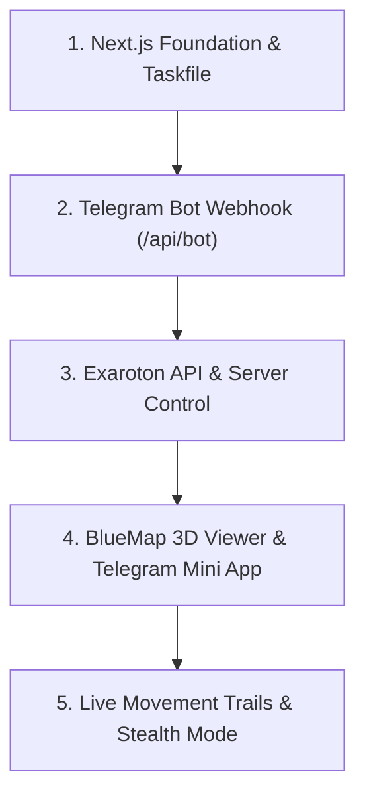

# Development Roadmap: ExServerWeb

This document defines the structured, incremental development plan for **ExServerWeb** — the Vercel-ready Next.js companion platform and Telegram Mini App for the FoMe server.

---

### Task 1: Next.js + TypeScript Foundation & Tooling Setup

- **Objective**: Bootstrap the Next.js App Router project with TypeScript, Tailwind CSS, and strict linting.
- **Deliverables**:
  - `package.json` with Next.js 14/15, React 18/19, TypeScript, Tailwind CSS, `grammy`, and `exaroton`.
  - `tsconfig.json`, `tailwind.config.ts`, `postcss.config.js`.
  - Minimal root layout (`app/layout.tsx`) and dark-themed dashboard page (`app/page.tsx`).
  - Working `Taskfile.yml` commands (`task lint`, `task build`, `task pre-commit`).
- **Acceptance Criteria**:
  - `task pre-commit` passes with 0 lint errors.
  - `task build` outputs production `.next` bundle without errors.

---

### Task 2: Telegram Bot Webhook Route (`POST /api/bot`) & Security

- **Objective**: Implement 24/7 serverless Telegram bot running via Vercel Route Handler.
- **Deliverables**:
  - Route handler `app/api/bot/route.ts` powered by `grammY` using webhook mode.
  - Secret token validation via `TELEGRAM_WEBHOOK_SECRET` header (`X-Telegram-Bot-Api-Secret-Token`).
  - Strict Authorization Middleware: only Chat IDs in `TELEGRAM_ALLOWED_USERS` can execute commands.
  - Interactive `/start` and `/menu` response with inline keyboard:
    - `[ 🟢 Включить сервер ]`
    - `[ 🔴 Выключить сервер ]`
    - `[ 📊 Статус сервера ]`
    - `[ 🗺️ Открыть 3D Карту ]` (Web App Button)
    - `[ 🤖 Спавн АФК Бота ]`
- **Acceptance Criteria**:
  - Webhook accepts simulated Telegram updates and dispatches inline keyboard.
  - Unauthorized users are rejected.

---

### Task 3: Exaroton API Client & Remote Server Controls

- **Objective**: Connect Telegram bot and API to Exaroton server lifecycle and Carpet commands.
- **Deliverables**:
  - Exaroton service client (`lib/exaroton.ts`) utilizing `EXAROTON_API_TOKEN` and `EXAROTON_SERVER_ID`.
  - Endpoint `GET /api/status` returning JSON: power status (`ONLINE`, `OFFLINE`, `STARTING`), player count, RAM.
  - Bot handlers:
    - Server Start / Stop / Restart with instant Telegram feedback.
    - Status query with formatted Markdown report.
    - AFK Bot Spawner: sends `/player Steve spawn` or `/player Steve kill` via Exaroton console API.
- **Acceptance Criteria**:
  - Status endpoint queries Exaroton API cleanly with error handling when offline.
  - Bot commands trigger appropriate Exaroton API actions.

---

### Task 4: BlueMap 3D Viewer & Telegram Mini App Integration

- **Objective**: Create the interactive 3D Web Dashboard compatible with desktop browsers and Telegram Mini Apps.
- **Deliverables**:
  - Fullscreen responsive BlueMap viewport component (`components/BlueMapView.tsx`) embedding `NEXT_PUBLIC_BLUEMAP_URL`.
  - Telegram Mini App viewport auto-expansion (`Telegram.WebApp.expand()`) and theme synchronization.
  - Modern floating HUD overlay:
    - Pulsing server status badge (Online / Offline).
    - Player count and online player list.
    - Quick actions bar (Haptic feedback on tap via `Telegram.WebApp.HapticFeedback`).
- **Acceptance Criteria**:
  - Opening the web app in browser or Telegram displays responsive 3D map with overlay HUD.

---

### Task 5: Live Movement Breadcrumbs & Hide & Seek Stealth Mode

- **Objective**: Render real-time movement traces and enforce anti-cheat concealment during Hide & Seek.
- **Deliverables**:
  - Breadcrumb trail layer: renders player paths with distinct colors (e.g. Cyan for Soroqn, Orange for brother) with time-decay.
  - Stealth Invariant:
    - Listens/queries match status from server mod.
    - If Hide & Seek is active (`HIDING` / `SEEKING`):
      - Suppress player pins and recent movement trails.
      - Display prominent top alert: `[ 🕵️ ПРЯТКИ АКТИВНЫ: Местоположение игроков засекречено ]`.
    - Restore pins and trails when match concludes.
- **Acceptance Criteria**:
  - Map viewer displays trails during normal survival, instantly masks them when Hide & Seek is active.
